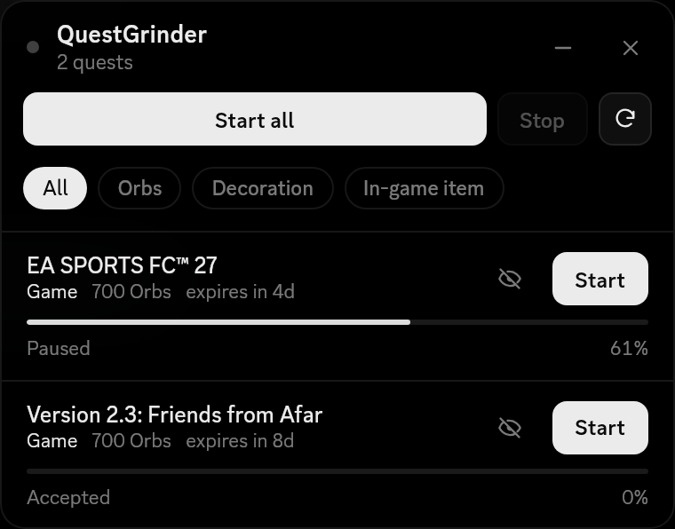

# QuestGrinder

[](https://github.com/Equicord/Equicord)
[](LICENSE)
[](https://github.com/shinishiz/QuestGrinder/commits/main)

Userplugin do [Equicord](https://github.com/Equicord/Equicord) que completa suas missões do Discord automaticamente, uma por vez, com um painel flutuante pra acompanhar a fila.

<p align="center"></p>

*[English below](#english)*

## O que ele faz

- Faz as missões de **vídeo**, **jogo** e **atividade**, uma por vez, no ritmo do app oficial. Jogo e atividade só funcionam no app do Discord para PC
- Aceita a missão sozinho, sem precisar abrir a página de missões
- Para a fila inteira se o Discord der erro ou limitar as requisições
- Filtra por recompensa: Orbs, decoração ou item de jogo
- Limite de missões por dia, opcional
- Avisa quando aparece missão nova e quando a fila termina
- Ordenação **QuestGarden** na página de missões, com as não concluídas primeiro
- Se atualiza sozinho pelo GitHub

Abra o painel pelo botão na barra do chat, pelo botão ao lado do saldo de Orbs ou com `/questgrinder`.

## Instalação

Precisa do Equicord compilado do código-fonte (veja o README do [Equicord](https://github.com/Equicord/Equicord)).

Instale **com `git clone`**. É isso que faz o plugin se atualizar sozinho:

```sh
cd Equicord/src/userplugins
git clone https://github.com/shinishiz/QuestGrinder questGrinder
cd ../..
pnpm build
pnpm inject   # só se o Equicord ainda não estiver injetado
```

Reinicie o Discord e ative o **QuestGrinder** em Configurações → Plugins.

## Atualizações

Você não precisa baixar de novo. O plugin confere este repositório quando o Discord abre e a cada 6 horas, e baixa as mudanças (`git pull`):

- a atualização entra sozinha na próxima vez que o **Equicord atualizar**;
- ou clique na notificação **"QuestGrinder atualizado"** pra aplicar na hora (o Discord reinicia).

Dá pra desligar isso nas opções do plugin.

Se você baixou o ZIP em vez de usar `git clone`, a atualização automática não funciona. Apague a pasta e instale de novo com `git clone`. Se você editou os arquivos do plugin, o update é pulado pra não apagar suas mudanças; rode `git stash` ou `git checkout .` dentro da pasta do plugin pra voltar a receber.

## Idioma

O plugin fica em português quando o Discord está em português, e em inglês em qualquer outro idioma.

## Aviso

Automatizar missões vai contra os Termos de Serviço do Discord. Use por sua conta e risco.

## Créditos e licença

Feito por **chess**. Licença GPL-3.0-or-later, a mesma do Vencord/Equicord.

Você pode estudar, modificar e redistribuir o código, mas a licença exige que você:

- mantenha o aviso de copyright e os créditos do autor original;
- distribua sua versão com o código-fonte e sob a mesma licença GPL-3.0;
- deixe claro o que foi alterado.

Remover os créditos ou relançar o plugin como se fosse seu viola a licença.

---

## English

An [Equicord](https://github.com/Equicord/Equicord) userplugin that completes your Discord quests automatically, one at a time, with a floating panel to follow the queue. The plugin shows up in English whenever your Discord isn't set to Portuguese.

<p align="center"></p>

### Features

- Completes **video**, **game** and **activity** quests one at a time, at the official app's pace. Game and activity quests need the Discord desktop app
- Accepts quests on its own, no need to open the quests page
- Stops the whole queue if Discord returns an error or rate limits
- Filter by reward: Orbs, decoration or in-game item
- Optional daily quest limit
- Notifies you about new quests and when the queue finishes
- **QuestGarden** sort option on the quests page, unfinished quests first
- Updates itself from GitHub

Open the panel from the chat bar button, the button next to your Orbs balance, or with `/questgrinder`.

### Install

Requires Equicord built from source. Install **with `git clone`** so the plugin can update itself:

```sh
cd Equicord/src/userplugins
git clone https://github.com/shinishiz/QuestGrinder questGrinder
cd ../..
pnpm build
pnpm inject   # only if Equicord isn't injected yet
```

Restart Discord and enable **QuestGrinder** in Settings → Plugins.

### Updates

The plugin checks this repository when Discord starts and every 6 hours, and pulls new changes. They're applied with the next Equicord update, or right away if you click the **"QuestGrinder updated"** notification (Discord restarts). ZIP downloads don't auto-update, and local edits to the plugin files pause updates until you run `git stash` or `git checkout .` in the plugin folder.

### Disclaimer

Automating quests is against Discord's Terms of Service. Use at your own risk.

### License

Made by **chess**. GPL-3.0-or-later. You're free to study, modify and share it, but you must keep the copyright notice and author credits, release your version's source under GPL-3.0, and state your changes.
