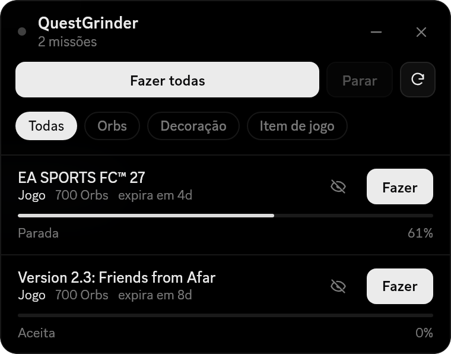

# QuestGrinder

[](https://github.com/shinishiz/QuestGrinder/releases/latest)
[](https://github.com/Equicord/Equicord)
[](LICENSE)

**Português** · [English](#english)

Userplugin do [Equicord](https://github.com/Equicord/Equicord) que completa suas missões do Discord automaticamente, uma por vez, com um painel flutuante pra acompanhar e controlar a fila.

[Instalação](#instalação) · [Compatibilidade](#compatibilidade) · [Perguntas frequentes](#perguntas-frequentes) · [Versões](https://github.com/shinishiz/QuestGrinder/releases) · [Reportar problema](https://github.com/shinishiz/QuestGrinder/issues/new/choose)

<p align="center"></p>

## O que ele faz

- Faz as missões de **vídeo**, **jogo** e **atividade**, uma por vez, no ritmo do app oficial. Jogo e atividade só funcionam no app do Discord para PC
- Aceita a missão sozinho, sem precisar abrir a página de missões
- Só conta a missão como feita depois que o Discord confirma
- Para a fila inteira se o Discord der erro ou limitar as requisições
- Filtra por recompensa: Orbs, decoração ou item de jogo
- Limite de missões por dia, opcional
- Avisa quando aparece missão nova e quando a fila termina
- Ordenação **QuestGarden** na página de missões, com as não concluídas primeiro
- Se atualiza sozinho pelo GitHub

Abra o painel pelo botão na barra do chat, pelo botão ao lado do saldo de Orbs ou com `/questgrinder`.

## Instalação

Precisa do Equicord compilado do código-fonte (veja o README do [Equicord](https://github.com/Equicord/Equicord)).

Instale **com `git clone`**. É isso que faz o plugin se atualizar sozinho. A pasta `userplugins` não vem com o Equicord, então o primeiro comando cria ela:

```sh
mkdir -p Equicord/src/userplugins
cd Equicord/src/userplugins
git clone https://github.com/shinishiz/QuestGrinder questGrinder
cd ../..
pnpm build
pnpm inject   # só se o Equicord ainda não estiver injetado
```

Reinicie o Discord e ative o **QuestGrinder** em Configurações → Plugins.

## Compatibilidade

| | |
|---|---|
| Versão atual | [](https://github.com/shinishiz/QuestGrinder/releases/latest) |
| Testado com | Equicord `a5753f70` (28/10/2026), Discord Stable 1.0.167 |
| Linux | Testado |
| Windows e macOS | Não testado ainda. O plugin não usa nada específico do Linux, mas o atualizador precisa do `git` e do `node` no PATH, como o próprio Equicord |
| Vesktop e Equibop | Só missões de vídeo. Jogo e atividade precisam do app oficial do Discord |

Cada [versão](https://github.com/shinishiz/QuestGrinder/releases) informa em que ambiente foi testada.

## Atualizações

Você não precisa baixar de novo. O plugin confere este repositório quando o Discord abre e a cada 6 horas, e baixa as mudanças (`git pull`):

- a atualização entra sozinha na próxima vez que o **Equicord atualizar**;
- ou clique na notificação **"QuestGrinder atualizado"** pra aplicar na hora (o Discord reinicia).

Dá pra desligar isso nas opções do plugin.

## Perguntas frequentes

**Baixei o ZIP e não atualiza.**
A atualização automática só funciona com `git clone`. Apague a pasta do plugin e instale de novo seguindo a [instalação](#instalação).

**Parou de atualizar depois que eu mexi nos arquivos.**
Se você editou algum arquivo do plugin, a atualização é pulada pra não misturar suas mudanças com o código novo. Dentro da pasta do plugin, rode `git stash` pra guardar suas mudanças (dá pra recuperar depois com `git stash pop`), ou `git checkout .` pra **apagar** suas mudanças de vez.

**Apareceu "Os patches não carregaram".**
O Discord mudou alguma coisa que o plugin usa. A fila fica travada pra não fazer nada errado. Reinicie o Discord; se continuar, espere uma atualização do plugin ou [avise aqui](https://github.com/shinishiz/QuestGrinder/issues/new/choose).

**Apareceu "Desative ... e reinicie o Discord".**
Outro plugin de missões está ligado ao mesmo tempo. Desative o que aparece na mensagem.

**Missão de jogo aparece como "Só no app do PC".**
Missões de jogo e atividade só funcionam no app oficial do Discord para computador.

## Aviso

Automatizar missões vai contra os Termos de Serviço do Discord. Use por sua conta e risco.

## Créditos e licença

Feito por **chess** ([@shinishiz](https://github.com/shinishiz)). Código sob a [GPL-3.0-or-later](LICENSE), a mesma do Vencord/Equicord: pode estudar, modificar e redistribuir, mantendo os créditos, o código aberto e a mesma licença.

---

## English

**English** · [Português](#questgrinder)

An [Equicord](https://github.com/Equicord/Equicord) userplugin that completes your Discord quests automatically, one at a time, with a floating panel to follow and control the queue. The plugin shows up in English whenever your Discord isn't set to Portuguese.

<p align="center"></p>

### Features

- Completes **video**, **game** and **activity** quests one at a time, at the official app's pace. Game and activity quests need the Discord desktop app
- Accepts quests on its own, no need to open the quests page
- Only counts a quest as done once Discord confirms it
- Stops the whole queue if Discord returns an error or rate limits
- Filter by reward: Orbs, decoration or in-game item
- Optional daily quest limit
- Notifies you about new quests and when the queue finishes
- **QuestGarden** sort option on the quests page, unfinished quests first
- Updates itself from GitHub

Open the panel from the chat bar button, the button next to your Orbs balance, or with `/questgrinder`.

### Install

Requires Equicord built from source. Install **with `git clone`** so the plugin can update itself. The `userplugins` folder doesn't ship with Equicord, so the first command creates it:

```sh
mkdir -p Equicord/src/userplugins
cd Equicord/src/userplugins
git clone https://github.com/shinishiz/QuestGrinder questGrinder
cd ../..
pnpm build
pnpm inject   # only if Equicord isn't injected yet
```

Restart Discord and enable **QuestGrinder** in Settings → Plugins.

### Compatibility

Tested on Linux with Equicord `a5753f70` (2026-10-28) and Discord Stable 1.0.167. Windows and macOS aren't tested yet; nothing in the plugin is Linux-specific, but the updater needs `git` and `node` on your PATH, just like Equicord itself. On Vesktop and Equibop only video quests work. Each [release](https://github.com/shinishiz/QuestGrinder/releases) lists the environment it was tested on.

### Updates

The plugin checks this repository when Discord starts and every 6 hours, and pulls new changes. They're applied with the next Equicord update, or right away if you click the **"QuestGrinder updated"** notification (Discord restarts).

### FAQ

- **Downloaded the ZIP and it doesn't update:** auto-updates only work with `git clone`. Delete the plugin folder and install again.
- **Stopped updating after I edited files:** updates are skipped while plugin files have local edits. In the plugin folder, run `git stash` to set your changes aside (bring them back with `git stash pop`), or `git checkout .` to **discard** them for good.
- **"The patches didn't load":** Discord changed something the plugin relies on, so the queue stays locked. Restart Discord; if it persists, wait for an update or [report it](https://github.com/shinishiz/QuestGrinder/issues/new/choose).
- **"Disable ... and restart Discord":** another quest plugin is enabled at the same time. Disable the one named in the message.

### Disclaimer

Automating quests is against Discord's Terms of Service. Use at your own risk.

### License

Made by **chess** ([@shinishiz](https://github.com/shinishiz)). Licensed under [GPL-3.0-or-later](LICENSE): you may study, modify and share it, keeping the credits, the source open and the same license.
